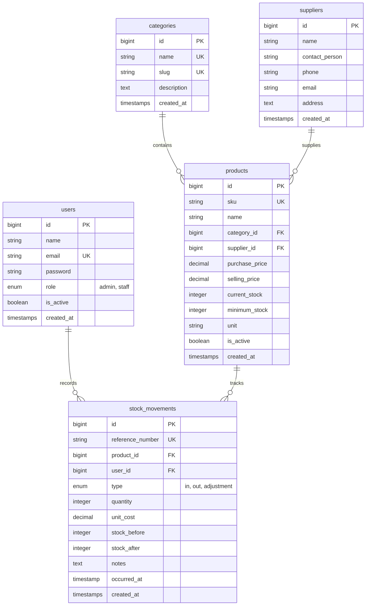

# StockWise — Sistem Manajemen Inventaris UMKM

> **"Stok terpantau, usaha lebih terkendali."**

StockWise adalah aplikasi web manajemen inventaris berbasis Laravel 10 yang dirancang khusus untuk memfasilitasi pemilik usaha mikro, kecil, dan menengah (UMKM) serta toko lokal di Indonesia. Aplikasi ini menggantikan pencatatan manual di buku kasir atau spreadsheet rumit dengan alur kerja yang terstruktur, andal, dan aman.

---

## Fitur Utama

1. **Katalog Produk Terstruktur:**
   - Pencatatan SKU unik, kategori, supplier, harga beli (HPP), harga jual, unit/satuan, dan ambang batas minimum stok.
   - Status otomatis (*Tersedia*, *Stok Menipis*, *Habis*).
   - Pencegahan penghapusan tidak aman (*safe delete*) bagi produk yang telah memiliki riwayat mutasi.

2. **Logika Bisnis Mutasi Stok yang Kuat (*Stock Movement Engine*):**
   - Pencatatan transaksi **Barang Masuk** (menambah stok fisik & mencatat unit cost).
   - Pencatatan transaksi **Barang Keluar** (mengurangi stok fisik).
   - **Row-level database locking & atomic transactions**: Mencegah race condition saat transaksi bersamaan.
   - **Non-negative stock validation**: Sistem secara tegas menolak barang keluar jika stok tidak mencukupi.
   - **Audit Trail Lengkap**: Menyimpan referensi unik, `stock_before`, `stock_after`, waktu riil transaksi, dan user pencatat.

3. **Dashboard Operasional & Visualisasi Data:**
   - Metrik riil langsung dari database: Total produk aktif, total unit fisik, peringatan stok menipis, dan transaksi bulan berjalan.
   - Grafik interaktif tren mutasi 30 hari terakhir menggunakan **Chart.js**.
   - Daftar pintas barang yang butuh restok mendesak.

4. **Laporan & Ekspor:**
   - **Laporan Inventaris Saat Ini**: Valuasi aset total berdasarkan harga beli serta filter kategori/ketersediaan.
   - **Laporan Pergerakan Stok**: Filter rentang tanggal fleksibel serta rekapitulasi volume keluar/masuk.
   - **Peringatan Stok Menipis & Habis**: Pemisahan jelas produk kritis.
   - **Ekspor CSV**: Pengunduhan laporan dengan sanitasi formula injection protection (`=`, `+`, `-`, `@`).

5. **Otentikasi & Otorisasi Berbasis Peran (*RBAC*):**
   - **Administrator**: Akses penuh, manajemen master data (produk, kategori, supplier), laporan, dan manajemen pengguna.
   - **Staf Gudang**: Melihat katalog produk, mencatat barang masuk/keluar, dan meninjau riwayat transaksi harian.

---

## 🛠️ Tech Stack

- **Backend Framework**: Laravel 10 (PHP 8.1+)
- **Database**: MySQL / MariaDB (Didukung SQLite untuk pengujian otomatis)
- **Frontend / UI**: Laravel Blade Templates, Tailwind CSS
- **Interaktivitas & Grafik**: Alpine.js, Chart.js, Lucide Icons
- **Pengujian**: PHPUnit 10 (67 tests, 137 assertions passing)

---

## 📋 Skema Relasi Database (ERD)



---

## ⚙️ Panduan Instalasi & Menjalankan Aplikasi

### 1. Prasyarat Sistem
- PHP >= 8.1 dengan ekstensi `pdo_mysql`, `pdo_sqlite`, `mbstring`, `fileinfo`, `openssl`.
- Composer 2.x
- Node.js & npm (v18+)
- MySQL / MariaDB (misal via XAMPP)

### 2. Konfigurasi Lingkungan (.env)
Buka file `.env` di folder `stockwise` dan pastikan konfigurasi database sesuai:
```env
APP_NAME=StockWise
APP_ENV=local
APP_DEBUG=true
APP_URL=http://localhost:8000

DB_CONNECTION=mysql
DB_HOST=127.0.0.1
DB_PORT=3306
DB_DATABASE=stockwise
DB_USERNAME=root
DB_PASSWORD=
```

### 3. Persiapan Database
1. Buka XAMPP Control Panel dan jalankan service **MySQL**.
2. Buat database:
   ```sql
   CREATE DATABASE stockwise CHARACTER SET utf8mb4 COLLATE utf8mb4_unicode_ci;
   ```
3. Jalankan migrasi dan seeder data awal:
   ```bash
   php artisan migrate:fresh --seed
   ```

### 4. Akun Pengguna Bawaan (Development Seeding)

| Peran (Role) | Email | Password |
|---|---|---|
| **Administrator** | `admin@stockwise.test` | `admin123456` |
| **Staf Gudang** | `staff@stockwise.test` | `staff123456` |

> *Catatan: Akun di atas dibuat khusus untuk lingkungan development. Ganti password sebelum deploy ke server produksi.*

### 5. Kompilasi Aset & Menjalankan Server
Jalankan kompilasi aset frontend dan development server:
```bash
# Kompilasi frontend
npm run build

# Menjalankan server aplikasi
php artisan serve
```
Buka browser di: [http://localhost:8000](http://localhost:8000).

---

## 🧪 Pengujian Otomatis (Automated Testing)

StockWise dilengkapi test suite lengkap untuk memverifikasi logika bisnis, integritas data, otentikasi, dan otorisasi:
```bash
# Menjalankan seluruh rangkaian tes
./vendor/bin/phpunit
```

Hasil verifikasi:
```text
OK (67 tests, 137 assertions)
```

Cakupan pengujian:
- ✅ **Authentication**: Login, logout, proteksi rute, isolasi akun nonaktif.
- ✅ **Role-Based Access Control (RBAC)**: Batasan staf vs admin pada pengelolaan pengguna, produk, dan supplier.
- ✅ **Stock Movement Logic**:
  - Penambahan stok fisik saat transaksi barang masuk.
  - Pengurangan stok fisik saat transaksi barang keluar.
  - Penolakan transaksi keluar saat stok tidak mencukupi (pencegahan stok negatif).
  - Penolakan kuantitas 0 atau negatif.
  - Keunikan nomor referensi mutasi.
  - Konsistensi audit trail (`stock_before` dan `stock_after`).
- ✅ **Product Rules**: SKU unik, inisialisasi stok awal dari 0, proteksi penghapusan produk bereferensi transaksi, formula status ketersediaan.

---

## 📁 Struktur Arsitektur Kode Utama

- `app/Services/StockMovementService.php` — Pusat logika bisnis transaksi stok dengan DB transaction dan locking.
- `app/Http/Controllers/`
  - `DashboardController.php` — Agregasi statistik inventaris & data Chart.js.
  - `ProductController.php` — Manajemen katalog, pencarian, filter stok, proteksi hapus.
  - `StockMovementController.php` — Alur pencatatan masuk/keluar & ekspor CSV.
  - `ReportController.php` — Laporan inventaris, mutasi stok, dan stok menipis.
  - `CategoryController.php` & `SupplierController.php` — Master data terproteksi.
  - `UserController.php` — Manajemen akun pengguna (khusus admin).
- `app/Http/Middleware/EnsureUserRole.php` — Penegakan otorisasi peran pada rute aplikasi.
- `resources/views/`
  - `layouts/app.blade.php` — Shell utama aplikasi yang responsif desktop & mobile.
  - `components/` — Sidebar, topbar, flash-message.
  - `dashboard.blade.php`, `products/`, `stock-movements/`, `reports/`, dll.
